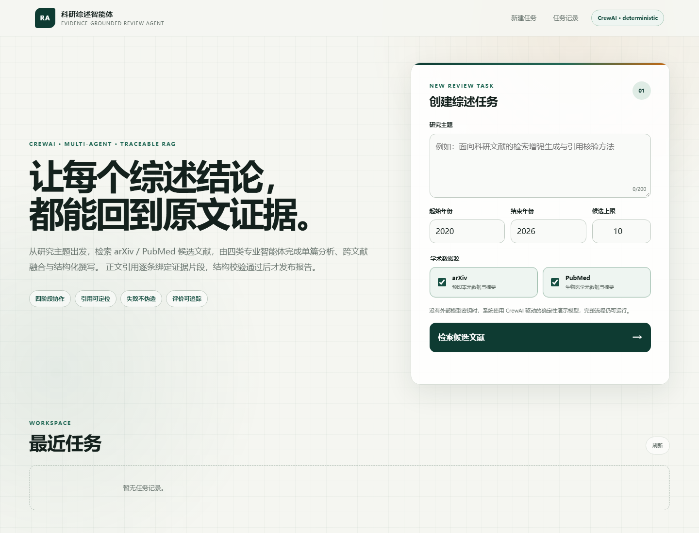

# 科研文献智能综述生成系统

基于 **CrewAI 多智能体协同 + 可追溯 RAG + 引用校验** 的科研文献综述生成 Web 原型。

本项目依据仓库中的《科研文献智能综述生成系统_需求分析设计.docx》（版本 1.1）实现，覆盖需求文档中的核心闭环：




- 研究主题、年份范围、学术源与候选数量输入校验
- arXiv / PubMed 候选检索、强标识去重与疑似重复标记
- 本地论文文件夹模式：直接读取 PDF/TXT/MD，不发起在线检索
- 候选文献确认与不可变选择快照
- CrewAI 四类专业任务：检索整备、单篇分析、跨文献对比、结构化撰写
- 本地混合 RAG：BM25 + 字符向量相似度，证据片段带稳定标识与定位
- 本地论文支持页码级全文证据定位，引用可回溯到 PDF 页和片段
- 四章节报告：研究背景、主流方法分类、技术演进路线、未解决问题
- 正文引用解析、证据归属检查、一次校正与失败终止
- 异步任务状态、SSE 进度、失败原因与关联重试
- 报告浏览、证据抽屉、单篇/跨文献分析查看
- 领域评审员 5 维量表评价记录
- 基于会话 Cookie 的任务/报告隔离

## 快速开始

项目要求 Python 3.11，使用现成 Conda 环境 `CrewAI`。

```powershell
# 在仓库根目录
Set-Location E:\learning\courses\Paper-Agent

# 安装/更新依赖（现有环境已安装 CrewAI 时可跳过）
D:\environment\Anaconda\Scripts\conda.exe run -n CrewAI python -m pip install -r requirements.txt

# 启动 Web 原型
D:\environment\Anaconda\Scripts\conda.exe run --no-capture-output -n CrewAI python -m uvicorn paper_review_agent.api:app --host 127.0.0.1 --port 8000
```

也可以运行：

```powershell
.\run.ps1
```

打开：

- Web 原型：`http://127.0.0.1:8000/`
- OpenAPI：`http://127.0.0.1:8000/docs`
- 健康检查：`http://127.0.0.1:8000/api/v1/health`

## 模型模式

### 1. 无密钥演示模式（默认可用）

没有配置 `PAPER_AGENT_LLM_API_KEY` 时，系统自动使用 `DeterministicReviewLLM`。它不是绕过 CrewAI，而是作为 CrewAI Agent 的受控本地模型，仍然执行真实的四个 CrewAI Task、任务上下文传递和结构化 Pydantic 输出，便于课程验收与自动化测试。

### 2. 真实大模型模式

复制 `.env.example` 为 `.env`，填写：

```dotenv
PAPER_AGENT_ENGINE_MODE=crewai
PAPER_AGENT_LLM_MODEL=openai/gpt-4o-mini
PAPER_AGENT_LLM_API_KEY=你的密钥
PAPER_AGENT_LLM_BASE_URL=
```

`PAPER_AGENT_LLM_MODEL` 遵循 CrewAI / LiteLLM 的模型字符串格式。密钥只从环境变量读取，不进入页面、报告或普通日志。

### 3. OpenAI 兼容接口

默认 `PAPER_AGENT_LLM_STRUCTURED_OUTPUT_MODE=auto`：官方 OpenAI 地址使用原生 JSON Schema 结构化输出；DeepSeek 等 OpenAI 兼容地址改为“提示词约束 JSON + 本地 Pydantic 校验”，避免接口不支持 `response_format` 时任务失败。如需手动覆盖，可设置为 `native` 或 `json_text`。

## 检索模式

- 默认按用户选择检索 arXiv 与 PubMed。
- 单个来源失败不会伪造“没有论文”，而是保留来源错误与其他来源结果。
- 两个外部来源都失败且 `PAPER_AGENT_OFFLINE_FALLBACK=true` 时，会切换到 `data/fixtures/papers.json` 受控测试语料，并在页面和报告中明确标记“受控示例/测试模式”。
- 受控语料只用于流程验收，不应据此形成真实学术结论。

## 本地论文模式

将论文放入 `local_papers/inbox/`，然后在网页首页选择“本地论文文件夹”：

- 支持 `.pdf`、`.txt`、`.md`，可直接使用文件夹中的多篇论文。
- 不调用 arXiv、PubMed 或检索模型，直接从全文建立候选和证据。
- PDF 证据定位格式为“全文（PDF），第 N 页，片段 M”。
- 本地候选默认全选，用户可取消不需要的论文后开始生成。
- 默认目录可通过 `PAPER_AGENT_LOCAL_PAPER_DIR` 修改。
- 开发样例位于 `local_papers/samples/`，不会自动混入用户 inbox。
- 扫描版 PDF 如无可提取文本，需先进行 OCR。

## 项目结构

```text
paper_review_agent/
  api.py             FastAPI 路由、SSE、会话范围与错误响应
  models.py          Pydantic 领域模型、输入规则与状态枚举
  repository.py      SQLite 持久化、状态机与任务/报告/评价存储
  retrieval.py       arXiv/PubMed/夹具检索、重试、去重与证据切分
  local_papers.py    本地 PDF/TXT/MD 解析、元数据识别、全文证据切分
  rag.py             BM25 + 字符向量混合证据检索
  deterministic.py   可复现的分析、比较与写作规则
  crew.py            CrewAI 四类 Agent/Task 与确定性 LLM
  validation.py      章节、引用、归属与一次校正
  service.py         异步编排、阶段状态与失败处理
  static/            无构建步骤的 Web 前端
app.py               服务入口
data/fixtures/       受控测试文献
local_papers/inbox/  用户放置本地论文的默认目录
local_papers/samples/ 开发测试用公开 arXiv 论文
tests/               单元与端到端测试
docs/                架构与需求追踪
```

## 测试

```powershell
D:\environment\Anaconda\Scripts\conda.exe run -n CrewAI python -m pytest -q
```

当前测试覆盖：

- 输入边界、来源集合、评价量表字段
- DOI / arXiv 版本去重与弱重复标记
- RAG 相关性排序
- 悬空引用、错配引用、缺失章节与一次校正
- API 端到端：建任务 → 候选确认 → 报告 → 评价

## 关键设计

### 状态机

```text
pending → retrieving → awaiting_confirmation → analyzing → writing → validating → completed
                                                  └────────────── failed ──────────────┘
```

失败任务不能原地恢复；重试会新建任务并通过 `parent_task_id` 关联原任务。

### 引用链

```text
Claim（正文声明）
  → evidence_ids
  → EvidenceFragment（原文、scope、locator）
  → PaperCandidate（标题、作者、年份、来源、外部链接）
```

完成前要求：

1. 四个业务章节齐全；
2. 事实性声明必须有 `evidence_id`；
3. 引用必须能解析到当前任务证据；
4. 若声明标注了 `subject_paper_ids`，证据必须属于这些文献；
5. 自动词面支持度只产生人工抽查提示，不替代学术语义判断。

## 需求文档

原始需求文件同步在：

`需求分析/科研文献智能综述生成系统_需求分析设计.docx`

详细架构和需求追踪见：

- `docs/architecture.md`
- `docs/requirement-traceability.md`

## 当前边界

- 原型不提供注册、付费、团队协作、浏览器上传和多格式导出；本地论文通过文件夹读取。
- 在线检索主要使用元数据与摘要；本地论文模式使用 PDF 全文。未取得全文时不会宣称审阅全文。
- 扫描版 PDF 不内置 OCR，无文本时需要用户先完成 OCR。
- 自动校验保证结构与证据映射，不保证学术结论必然正确。
- SQLite 与线程池适合单机原型；生产化时应替换为持久任务队列和独立数据库。
